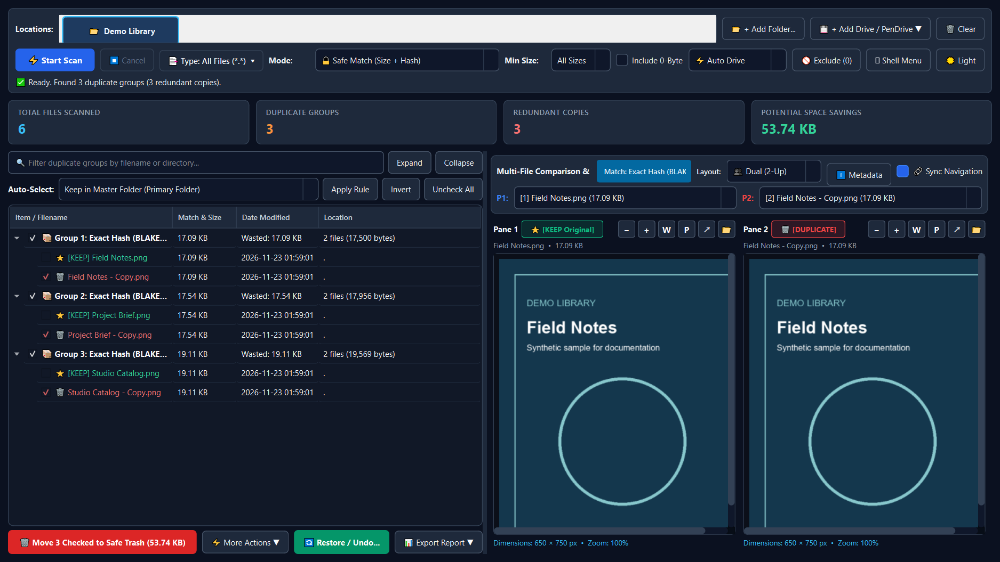
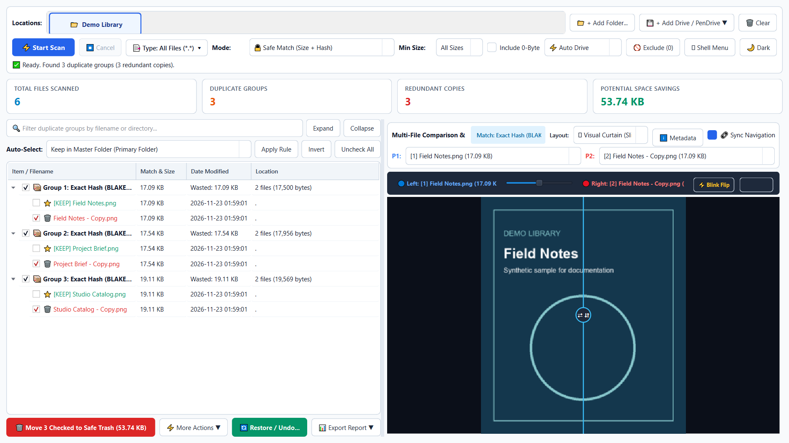

# Hybrid Duplicate Checker

**Find exact duplicates, compare similar files side by side, and review what to keep before moving anything.**

Hybrid Duplicate Checker is an open-source Windows desktop app for organizing local document and media collections. It pairs Czkawka’s BLAKE3 scanner with a review interface for PDFs, images, and other supported files. Scanning and previews run locally.


[](LICENSE)

[Quick start](#quick-start) · [Scan modes](#scan-modes) · [Safe cleanup](#safe-cleanup) · [Troubleshooting](#troubleshooting) · [Contributing](CONTRIBUTING.md)

## Screenshots



*Safe Match results and Dual comparison in the dark theme.*



*Visual Curtain comparison in the light theme. Both screenshots were captured from the running app with six synthetic sample images.*

## What you can do

- **Scan local folders and drives.** Add multiple locations, mark a reference folder, exclude paths, and filter by category, extension, or minimum size.
- **Review groups before taking action.** Search results, inspect file details, and apply keeper rules such as newest, cleanest name, or master folder. Check the file selections after applying a rule.
- **Compare files.** Use Dual, Triple, Quad, Carousel, Visual Curtain, or Difference Heatmap. Available preview controls vary by file format. PDF preview supports page navigation and zoom.
- **Quarantine and restore.** Safe Trash moves selected files to a local quarantine with a restore manifest. The action menu also includes Windows Recycle Bin, archive moves, hardlink replacement, and empty-folder cleanup.
- **Export reports.** Save results as an interactive HTML report, Excel workbook, or CSV.

## Quick start

**Supported setup for these instructions:** Windows x64, Python 3.12 and PowerShell. The current repository runs from source. A verified standalone Windows ZIP is not available yet.

```powershell
git clone https://github.com/amit358infinit-hub/Hybrid-Duplicate-Checker.git
cd Hybrid-Duplicate-Checker
py -3.12 -m venv .venv
.\.venv\Scripts\python.exe -m pip install -r sources/desktop_app/requirements.txt
```

Download [Czkawka CLI 12.0.2 for Windows x64](https://github.com/qarmin/czkawka/releases/download/12.0.2/windows_czkawka_cli.exe). Save it as `tools/czkawka-12.0.2/windows_czkawka_cli.exe`. Verify it before launching:

```powershell
Get-FileHash .\tools\czkawka-12.0.2\windows_czkawka_cli.exe -Algorithm SHA256
```

Expected SHA-256: `eb7c2009d2dd49cf5202acbd65370caece0a3f819b9515e727cedb1ec088ed1a`.

```powershell
.\.venv\Scripts\python.exe sources/desktop_app/main.py
```

If Python and the dependencies are already installed in your system environment, you can also double-click `run.bat`.

## First scan

1. Put two copies of a disposable file into a test folder.
2. Click **Add Folder**, select that folder, and check that the file-type filter includes your sample.
3. Choose **Safe Match** and click **Start Scan**.
4. Open a group and compare the files. Confirm which copy is marked **Keep**.
5. To practice recovery, move a checked disposable copy to **Safe Trash**, then recover it with **Restore / Undo**.

## Scan modes

| Mode | Comparison | Recommended use |
| --- | --- | --- |
| Safe Match | Size and full BLAKE3 via Czkawka | Default for exact duplicates |
| Full SHA-256 | Full content hash | Alternative exact match |
| Exact Name | File name | Find files that share a name |
| Similar Name | Normalized names and fuzzy similarity | Find renamed copies and possible versions |
| Same Page Count + Title | Document page count and title or name similarity | Review likely PDF or e-book variants |
| Visual Cover Match | Perceptual cover similarity with document checks | Review visually similar candidates |
| Ultra-Fast | File size | Quick shortlist for manual review |

**Name, size, page/title, and visual matches are candidates for review.** Two different files can match these criteria. Use Safe Match or Full SHA-256 for exact-copy cleanup.

## Safe cleanup

- Keep a separate backup of important files. Test cleanup and recovery on disposable copies first.
- Review checked rows and the retained copy before confirming any file action, especially when search filters are active.
- Safe Trash recovery requires the quarantine file and its manifest. Keep both until you have verified the result.
- Hardlinks share the same file content. Editing one linked path can also change what is read from the other. Use this action only for verified copies on a supported volume and only if you want shared content.
- Exported reports can contain filenames and paths. Review or redact them before sharing.

## Troubleshooting

| Symptom | What to check |
| --- | --- |
| Safe Match cannot start | Confirm the exact Czkawka path above and verify the CLI checksum. |
| A known copy is missing | Check roots, exclusions, file type and minimum-size filters. Use an exact mode for byte-identical copies. |
| A PDF preview is blank or shows an error | Try a known-good PDF. Encrypted, damaged, or unsupported documents may require a different tool. |
| A file action fails | Close the file in other apps, check target permissions and available space, and review any failed rows. |

For a reproducible problem, [open an issue](https://github.com/amit358infinit-hub/Hybrid-Duplicate-Checker/issues/new/choose) with the steps, Windows version, Python version and sanitized logs. Use [the security policy](SECURITY.md) for sensitive reports.

## Project layout

- `sources/desktop_app/` contains the PySide6 UI, scan workers, Czkawka adapter, preview pipeline, actions and exports.
- `tools/czkawka-12.0.2/` is the expected location of the separately downloaded Czkawka binary.
- `docs/screenshots/` holds the public screenshots.

## License and credits

Hybrid Duplicate Checker is available under [GNU AGPL v3](LICENSE). The separately downloaded [Czkawka](https://github.com/qarmin/czkawka) CLI retains its [upstream MIT license](tools/czkawka-12.0.2/LICENSE_MIT). Other dependencies retain their own licenses, including [Qt for Python](https://doc.qt.io/qtforpython-6/licenses.html) and [PyMuPDF](https://pymupdf.io/licensing).
